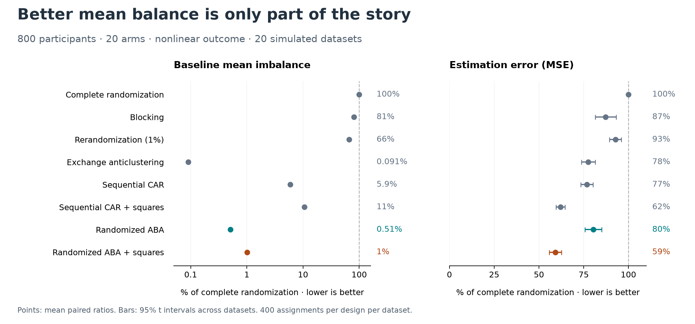

# randaba: balance treatment groups without giving up randomization

[](https://github.com/finite-sample/randaba/actions/workflows/ci.yml)
[](https://finite-sample.github.io/randaba/)

**Create balanced treatment groups without giving up randomization.**

`randaba` turns an existing fast balancing algorithm into a randomized
experimental design. It creates groups with similar baseline characteristics
while preserving unbiased treatment comparisons and valid randomization tests.
Use it for experiments with many treatment arms when participants' baseline
characteristics are known before assignment.

## The problem

Suppose you want to compare 20 interventions. Ordinary random assignment is
already unbiased, but the groups can differ by chance in age, prior behavior,
or other characteristics that predict the outcome. Those differences make
comparisons noisier. Balancing the groups before the experiment can improve
precision without recruiting more participants.

## What already exists

| Approach | How it balances groups | Tradeoff |
|---|---|---|
| Complete randomization | Assign participants at random | Simple and unbiased; leaves chance imbalance |
| Blocking | Randomize within sets of similar participants | Depends on how well the matching captures relevant differences |
| [Rerandomization](https://doi.org/10.1214/12-AOS1008) | Redraw until a balance threshold is met | Tighter thresholds require more draws |
| [Sequential adaptive randomization](https://arxiv.org/abs/2305.13842) | Favor assignments that improve balance as participants arrive | Suitable for enrollment over time; need not give exactly equal group sizes |
| [Exchange anticlustering](https://doi.org/10.1037/met0000301) | Repeatedly swap participants to make groups more alike | Strong balance; a full pass compares quadratically many pairs |
| [Assignment-based anticlustering (ABA)](https://arxiv.org/abs/2601.06351) | Spread each batch across groups using an assignment solver | Efficient balancing, but the original algorithm is deterministic |

## Our contribution

We build on **ABA by Baumann, Goldschmidt, Hochbaum, and Yang**:

1. **Make it a randomized experimental design.** Add noise to the ordering
   that forms batches, then randomly shuffle the final treatment labels.
   The label shuffle gives each participant the same chance of each treatment,
   making differences in means unbiased. Redrawing the same design gives a
   valid test of the sharp null of no treatment effects. The ordering noise
   lets group membership vary too, which matters for power; label shuffling
   alone is valid but can leave too few distinct comparisons.
2. **Connect it to an existing adaptive design.** For a given batch, ABA
   makes the same greedy balance-improving choice as
   [ARMM](https://doi.org/10.1016/j.csda.2022.107642), using one assignment
   problem instead of scoring all `K!` allocations across `K` arms.
   This is an equivalence of the greedy step, not of the full randomization
   procedures.
3. **Show when the balance helps.** Compare baseline balance, estimation
   error, and randomization tests across designs. In the simulations,
   balancing squared covariates as well as their means improves precision
   for a nonlinear outcome. Tight mean balance alone is not enough.

**Why it scales:** with `n` participants and `K` arms, there are `n/K`
batches. Each assignment solve takes `O(K³)`, so all solves together cost
`O(nK²)`. Holding the arm and feature counts fixed, the assignment pass is
**`O(n)`**: twice as many participants means twice as many batches.
Sorting adds `O(n log n)`, making the **full procedure `O(n log n)`**,
versus `O(n²)` for an exchange pass. This follows from counting operations;
see the [derivation](docs/method.md) for preprocessing and memory costs.

## Assign participants

Requires Python 3.12 or newer. Until the first PyPI release:

```bash
pip install git+https://github.com/finite-sample/randaba
```

Supply a matrix with one row per participant and one column per baseline
characteristic. The result is one treatment label per participant:

```python
import numpy as np

from randaba import designs

rng = np.random.default_rng(42)
x = rng.normal(size=(800, 5))  # Example baseline data; use your own matrix.
assignment = designs.randomized_aba(x, k=20, rng=rng)

print(np.bincount(assignment))  # 40 participants in each of 20 arms.
```

Labels run from `0` to `19`. Save the assignment you actually use, the
covariates, design settings, and dependency versions.

To balance the squares too, use `np.column_stack([x, x**2])` as the input
matrix. Choose the features before assigning treatments. For testing after
outcomes arrive, see the separate [randomization inference example](docs/inference.md).

## What the simulations show



**Setup:** 800 participants, 20 arms of 40, and five independent standard-normal
baseline covariates. We generate 20 independent datasets and draw 400
assignments per design per dataset. Every design sees the same data within
a dataset. Sequential designs allow small differences in arm sizes.
The outcome combines a linear term, squared terms and interactions, and
independent normal noise; the true treatment effect is zero.

Both panels show percentages of complete randomization's value, computed
within each dataset and then averaged; **lower is better**. Bars are 95%
Student-t intervals across the 20 datasets. The left panel measures imbalance
in baseline covariate means on a logarithmic scale. The right measures the
mean squared error of the difference in outcomes between two arms.
“+ squares” adds each covariate's square to the balancing features.

In this setting, randomized ABA leaves about **0.5% of baseline mean
imbalance**. Adding squares leaves about **1%**, but lowers estimation error
to about **60%** of complete randomization's. Exchange balances means even
more tightly, yet has higher estimation error for this nonlinear outcome.
These are results for this setup, not a guarantee for every experiment.

The [simulation guide](docs/simulations.md) gives the exact outcome model,
saved data, figure command, and full comparison across 4–50 arms.

## When to use it

Use randomized ABA when all participants' covariates are available before
assignment and you want equal group sizes across many arms. The participant
count must be divisible by the arm count. Covariates must be finite and have
full column rank after centering; remove constant or redundant columns.

For two arms, greedy pair-switching balanced better in our comparison.
For participants arriving over time, consider a sequential design. The
simulations use Gaussian covariates and one outcome model; results depend
on which outcome-relevant features you balance.

## Learn more

- [Method and operation counts](docs/method.md)
- [Randomization inference](docs/inference.md) and [API reference](https://finite-sample.github.io/randaba/api.html)
- [Reproduce the simulations](docs/simulations.md) and [research note](https://github.com/finite-sample/randaba/blob/main/paper/note.tex)
- [Development and local checks](docs/development.md), [release guide](docs/releasing.md), and [report an issue](https://github.com/finite-sample/randaba/issues)

## License

[MIT](https://github.com/finite-sample/randaba/blob/main/LICENSE).
