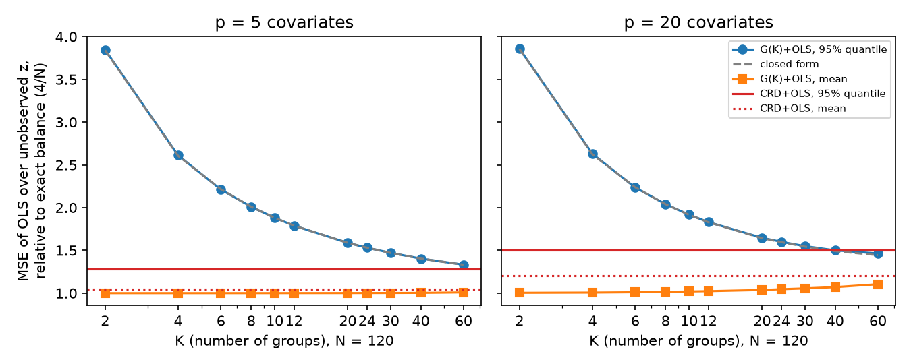

# Balancing at assignment: what it buys over regression and what it costs

## Abstract

Experimenters increasingly assign treatment with algorithms that make the arms
look alike on baseline covariates, such as rerandomization, matching and
anticlustering, and then analyse the data with regression. Simulation studies
find that regression recovers most of what such balancing buys. That leaves
practitioners with three unanswered questions: when balancing still pays, what
it costs in protection against unmeasured covariates, and how to keep inference
exact. We answer them for two-arm experiments analysed by ordinary least
squares (OLS).

- **What balance buys.** Exact balance beats complete randomization with OLS by
  a factor of at least `(N-1)/(N-1-p)`, and exactly `(N-3)/(N-p-3)` with
  Gaussian covariates. That is under 5% with a handful of covariates, which
  explains the published nulls, but 20 to 35% when there are 17 to 25
  covariates per 100 units.
- **What it costs.** The cost of balance lives in the distribution of possible
  assignments, not in any one of them. We make it explicit through grouped
  randomization, which anticlusters units into `K` groups and randomizes whole
  groups.
  - Every quantity has a closed form.
  - The MSE over unmeasured covariates has only `K - 1` degrees of freedom.
  - Any local optimum of the anticlustering carries a checkable bound on its
    remaining imbalance.
- **A hazard.** Small groups balanced on means alone make omitted squares and
  interactions up to 76% worse than complete randomization.
- **What works.** In a comparison at 17 to 25 covariates per 100 units, local
  search from many random starts (greedy pair-switching) reaches the
  exact-balance optimum on average. It also has the lightest tail of any
  design compared, and supports an exact randomization test. Matching or
  balancing squares as well guards against omitted nonlinearity.

The practical rule follows. With few covariates per unit, randomize and adjust.
With many, balance by local search from random starts, test by redrawing the
design, and balance the nonlinear terms the outcome may carry.

## Summary of results

| Question | Answer | Where |
|---|---|---|
| When does design-time balance beat OLS? | When `p/N` is not small: gain `(N-3)/(N-p-3)` | Theory, Prop. 2 |
| What does it cost? | `lambda_max`, `‖Sigma‖_F^2` and the mass on one partition. For `G(K)` these are `(N-1)/(K-1)`, `N^2/(K-1)` and `2/C(K,K/2)` | Props. 1, 5, 6 |
| How well do small groups balance? | A certificate at any local optimum; typical rate `m^{-(1+2/p)} N^{-2/p}` | Prop. 7 |
| How does coarse randomization show up in the tail? | The MSE over unmeasured covariates has `K - 1` degrees of freedom | Prop. 8 |
| What happens to omitted nonlinear terms? | Mean-only small groups make them worse; balancing them reverses it | Prop. 9 |
| Which design to use? | Local search from random starts; add moment balancing or matching for nonlinear outcomes | Section 5 |

Much of the framing is prior work: Kallus (2018, 2020), Krieger, Azriel and
Kapelner (2019), Kapelner et al. (2021), Li, Ding and Rubin (2018), and
Bertsimas, Johnson and Kallus (2015). Section 2 lists what each established.
What this report adds:

- the exact finite-sample accounting against OLS;
- the closed-form grouped family with its degrees-of-freedom result;
- the local-optimum certificate and rate;
- the omitted-structure identity;
- a comparison that puts these on one scale.

## 1. The question

Random assignment balances covariates on average, not in the draw you get. Two
remedies compete:

- **Balance at design time:** blocking, rerandomization, the Finite Selection
  Model (FSM), anticlustering.
- **Adjust at analysis time:** regression on the covariates.

To first order, adjustment recovers what design-time balance buys (Li and Ding
2020). Simulations agree (Green and Mikhaeil 2026; Papenberg and Angelike 2026).
The questions here are what balance buys beyond that, and what it costs in
randomization.

## 2. What already exists

| Approach | Balance | Randomness | Inference |
|---|---|---|---|
| Complete randomization | none by design | maximal | standard |
| Blocking, matched pairs and tuples (Bai 2022; Bai, Liu and Tabord-Meehan 2024) | similar units grouped, treatment varied within | within blocks | design-specific asymptotics |
| Rerandomization (Morgan and Rubin 2012) | Mahalanobis below a threshold | large | non-normal limit (Li, Ding and Rubin 2018); power (Branson, Li and Ding 2024) |
| Cluster rerandomization (Lu, Liu, Liu and Ding 2023) | arm balance over given clusters | restricted cluster assignments | asymptotic, needs a few dozen clusters; Fisher test for fewer |
| FSM (Morris 1979; Chattopadhyay, Morris and Zubizarreta 2026) | D-optimal sequential selection | random turn order; few partitions at small `N` with many covariates | randomization test |
| Gram-Schmidt Walk (Harshaw et al. 2024) | tunable | tunable, with a worst-case bound | design-based |
| Optimized partition, arms randomized (Bertsimas, Johnson and Kallus 2015) | means and second moments, cross-products included, by integer programming | one partition | bootstrap |
| Optimal designs (Kallus 2018, 2020) | minimax under an outcome class | mixed strategies, optionally constrained for Fisher's test | design-based |
| Greedy pair-switching (Krieger, Azriel and Kapelner 2019) | exchange to a local optimum from a random start; imbalance `O_p(n^{-(1+2/p)})` | close to complete randomization by pairwise entropy | randomization test over replicate designs |
| Matching, then greedy switching across pairs (Krieger, Azriel and Kapelner, arXiv:2012.03330) | pairs for nonlinear outcomes, plus mean balance | as random as matched pairs | randomization test |
| Tail-criterion rerandomization (Kapelner et al. 2021; arXiv:1905.03337) | threshold chosen by a quantile of MSE over unobserved covariates | tuned by that criterion | randomization test |
| Anticlustering for assignment (Papenberg and Angelike 2026) | best of the methods they compared | a random start and one exchange pass | t-test and OLS; a randomization test listed as future work |
| Assignment-based anticlustering, ABA (Baumann et al. 2026) | near-perfect on means; scales to millions | none (deterministic) | not designed for it |

The closest work is Kallus's.

- **Kallus (2018)** treats a design as a game against an adversarial outcome
  function from a stated class. Without structure, complete randomization is
  minimax and a single partition can be `N - 1` times worse. Under a correctly
  specified parametric class, optimal balancing reaches the regression-adjusted
  variance `1 - R^2` without bias. Its pure-strategy designs (a single best
  partition) cannot be tested by randomization, so he proposes a bootstrap
  test.
- **Kallus (2020)** constrains the minimax design so that no assignment exceeds
  probability `alpha / 2`, which keeps Fisher's test usable. He computes it with
  repeated mixed-integer programs and an `N x N` semidefinite program.

- **Kapelner, Krieger and coauthors** settle much of the rest.
  - Greedy pair-switching is the two-group exchange algorithm, and they
    already test it by redrawing the design (Krieger et al. 2019). So a
    randomization test for exchange anticlustering, which Papenberg and
    Angelike list as future work, exists.
  - Their pairwise-entropy measure of randomness is the pair check used in
    section 3.
  - Their tail criterion (Kapelner et al. 2021) penalizes `||Sigma||_F^2`,
    which favours designs between complete randomization and a single
    optimal partition.

`G(K)` sits in Kallus's constrained class. With `K` equal to the number of arms
it is Bertsimas, Johnson and Kallus's design. Its covariance is closed form and
it needs no solver. That makes Kapelner et al.'s criterion a one-dimensional
problem in `K` rather than something estimated by sampling. How close `G(K)`
comes to Kallus's constrained optimum is unknown. The specific construction,
many anticlusters randomized whole, was not found in the literature read, which
does not establish that it is new.

## 3. How anticlustering balances, and how to randomize it

ABA sorts units by distance from the centre and deals them out in shells of
`K`. Each shell goes one unit per group, by the matching that maximizes total
squared distance to the groups' current centroids. Expanding that objective
shows the matching minimizes `sum x_i . c_k`: each group receives the unit
pointing most against the way its centroid currently leans. That is the logic
of online vector balancing, which keeps drift bounded in that literature. No
such bound is proved here for ABA's shells. The FSM is the same family with a
different distance (leverage in the group's own covariance) and a random turn
order instead of a joint matching.

An ablation on 20,000 units, 8 covariates and 200 groups:

| Variant | Mean imbalance | Second-moment imbalance | Same-group pairs repeated across runs |
|---|---|---|---|
| Random partition | 8 | 36 | 0.005 |
| ABA | 0.005 | 56 | 1.0 (deterministic) |
| ABA, sort order jittered, labels shuffled | 0.005 | 56 | 0.005 |
| ABA given squares and cross-products as features | 0.013 | 0.08 | 1.0 |
| FSM distance in shells, random turn order | 0.035 | 0.19 | 0.005 |

The **shell draft** is ABA made random:

1. Whiten the covariates.
2. Sort units by distance from the centre times `exp(sigma Z)`, with `Z`
   standard normal (the jitter).
3. Cut the sorted list into shells of `K`.
4. Deal each shell by ABA's matching.
5. Shuffle the group labels at the end.

The pilot used `sigma = 1` and centroid distance. Its code is
`shelldraft.designs.shell_draft`.

What the ablation shows, and what it does not:

1. **Jittering the sort order left balance unchanged** and made pair
   co-membership look random. Pair co-membership is Krieger et al.'s (2019)
   pairwise-entropy measure. Neither the probability mass on each partition
   nor the assignment covariance (its `lambda_max` or Frobenius norm) was
   measured. Those decide robustness and testability. Room for randomness is
   plausible: Papenberg (2024) finds that good anticlustering partitions are
   plentiful and unlike each other. With 14 units, 8.5% of all splits came
   within 0.1% of the best k-means anticlustering value, and partitions from
   different criteria had near-zero adjusted Rand index.
2. **Shuffling labels at the end is mandatory.** Without it, jitter left some
   units in group 0 in 83% of draws. The pairs check could not see this,
   because it ignores labels.
3. **Balancing means can unbalance spread**, as Papenberg and Klau (2021)
   found for k-means anticlustering. Two fixes exist. The k-plus criterion
   (Papenberg 2024) appends each covariate's squared and higher deviations,
   which balances marginal variances, skewness and kurtosis but not
   covariances. He names covariances as future work.
   Balancing squares and cross-products together is the design of Bertsimas,
   Johnson and Kallus (2015), whose multivariate formulation includes the
   cross-moments, and Kallus's (2018) quadratic-kernel allocation. Either
   works only while the feature count stays well below `N`.

## 4. Theory

Full statements and proofs are in [Theory](theory.md). Two equal arms; `W` is
the `+/-1` assignment vector; `Sigma = E[WW']`.

1. **Error identity.** `tau_hat - tau = (2/N) W' mu`, with `mu_i` the average of
   unit `i`'s two potential outcomes. A design's randomization risk is all in
   `Sigma`.
2. **Variance budget.** Under label symmetry `tau_hat` is unbiased and
   `trace Sigma = N` for every design. Balance moves variance off the measured
   directions onto the rest. Averaged isotropically, the cost is
   `(N-1)/(N-p-1)`. In the worst direction it is `lambda_max`, up to `N`.
3. **A regression benchmark.** In a linear model with a constant effect and
   homoskedastic errors, OLS has `MSE = 4 sigma^2 E[1/(N-Q)]`, where `Q = W'P_X W`
   measures treatment-covariate collinearity. The pieces are known: Kapelner
   et al. (arXiv:1905.03337, eq. 6) give the design-averaged form to third
   order, and the Gaussian value is a classical inverse-Beta moment. Exact
   balance gains *at least*
   `(N-1)/(N-1-p)` over complete randomization with OLS, and exactly
   `(N-3)/(N-p-3)` with Gaussian covariates. That gain is 6% with one
   covariate at `N = 20`, consistent with Papenberg and Angelike's null. It is
   a finite-sample term beneath Li and Ding's first-order result, and it
   matters when `p/N` is not small. Papenberg and Angelike's own noise
   condition is consistent with it. With five irrelevant covariates added to
   the regression, adjusted power was 0.720 after anticlustering against 0.706
   after random assignment, compared with 0.722 and 0.719 with the one
   covariate alone.
4. **Omitted components.** If the design balances an outcome component that
   the regression omits, the gain grows by about `1 + V_g/sigma^2`. If it
   balances only the means, that component can get worse, not better.
5. **Inference.** The t-test is conservative when the design reduces the true
   variance, which is the intended case but is not guaranteed. A
   randomization test that redraws the design controls level for the sharp
   null (Morgan and Rubin 2012; Krieger et al. 2019). The weak null needs a
   studentized statistic. A design uniform over `M` partitions can reach
   p-values no smaller than `1/M` (Kallus 2020, Section 7).
6. **Grouped randomization `G(K)`**, conditional on the partition:
   - Every unit has probability 1/2.
   - The worst case is `(N-1)/(K-1)` times complete randomization.
   - `||Sigma||_F^2 = N^2/(K-1)`, the randomness term of Kapelner et al.'s
     criterion.
   - The smallest p-value is `2/C(K, K/2)`.
   - Expected imbalance is `E[Q] = (K m^2/(K-1)) trace(A^{-1} D'D)`, with `D` the
     group-mean deviations.
   - The group-level Neyman variance is conservative in expectation. A
     `t_{K-2}` reference is only an approximation: with `K = 8`, one null
     configuration rejects 14% of the time at a nominal 5%. Lu et al.'s
     simulations suggest normal-based intervals need a few dozen groups.
7. **Balance against group size.**
   - *A certificate (proved).* At any local optimum of the exchange method,
     `|d_g - d_h| <= rho_gh/m`. Here `rho_gh` is the smallest
     `|x_j - x_i|/cos theta` over cross-group pairs, and `theta` is the angle
     to the gap between the two group means. So
     `E[Q] <= sum_{g<h} rho_gh^2/((K-1)(N-1))`. This can be reported with any
     partition, and it held in all 400 simulated partitions.
   - *A rate (heuristic, checked).* Typically
     `E[Q] ~ c_p m^{-(1+2/p)} N^{-2/p}`. This extends Krieger et al.'s
     two-group rate, since a group can swap with every unit outside it. Over
     `N` from 240 to 960 and `p` from 1 to 10, the fitted exponents were
     within 0.05 of the prediction for `m` and within 0.12 for `N`.
8. **The tail criterion under `G(K)`.** With unobserved covariates modelled as
   independent normal `z`, the OLS MSE over `z` is a weighted sum of `chi2_1`
   variables.
   - Under `G(K)` the weights come from a `K x K` matrix and are exact given
     the partition.
   - With exact balance there are `K - 1` equal weights, so the MSE is
     `(4 sigma^2/N) chi2_{K-1}/(K-1)`.
   - The `q` quantile is about `(1 + E[Q]/N) chi2_{K-1}(q)/(K-1)` for `G(K)`,
     against `((N-3)/(N-p-3)) chi2_{N-p-1}(q)/(N-p-1)` for complete
     randomization with OLS. Both are relative to `4 sigma^2/N`. They match
     the exact computation within 1.3%.

   Choosing `K` means minimizing the first expression.
9. **Omitted structure.** For any omitted component `g`, the MSE under `G(K)`
   relative to complete randomization is exactly
   `R_g = ((N-1)/N) m s_b^2 / V_g`. Here `s_b^2` is the variance of `g`'s group
   means. `R_g` is computable before the experiment.
   - Mean-only anticlustering into small groups gave `R_g` of 1.33 to 1.76 for
     squares and interactions.
   - Balancing those terms too gave 0.41 to 0.81.

## 5. Evidence

The pilot ([details](pilot.md)) ran 400 datasets per cell with two arms and
200 reference draws per dataset. It compared complete randomization,
rerandomization, exchange anticlustering, the shell draft and the FSM. It did
not run `G(K)`. Gains are effective sample size relative to complete
randomization analysed with OLS, and carry about ±0.1 to 0.15 of simulation
noise.

| N | p | Exact balance (Gaussian `X`) | Rerandomization | Exchange anticlustering | Shell draft |
|---|---|---|---|---|---|
| 20 | 5 | 1.42 | 1.52 | 1.33 | 1.48 |
| 50 | 20 | 1.74 | 1.60 | 1.79 | 1.66 |
| 100 | 20 | 1.26 | 1.09 | 1.32 | 1.36 |
| 300 | 20 | 1.07 | 0.90 | 0.98 | 0.92 |

With 400 datasets the simulated values cannot separate the designs from each
other or from the formula. On the nonlinear outcome the FSM reached 1.6 at
`N = 100` and `300`. That is in line with the omitted-component heuristic, but
the pilot's quadratic term was not orthogonal to `X` in each sample, so this
is not a test of it. At small `N` with many covariates the FSM produced a few
dozen distinct allocations, and its randomization tests had little power.

The t-test against the randomization test, under exchange anticlustering with
5 covariates, where half the outcome variance is balanced away
(`kappa = 0.71`):

| | t-test size | t-test power | Randomization-test power |
|---|---|---|---|
| Predicted | 0.006 | 0.50 | 0.79 |
| Simulated | 0.003 to 0.007 | 0.43 to 0.51 | 0.76 to 0.81 |

### `G(K)` (`scripts/gk_rate.py`, `scripts/gk_tail.py`)

At `N = 120`, five covariate draws per setting, and MSE relative to an exactly
balanced design (`4 sigma^2/N`):

| p | Design | Mean | 95% quantile |
|---|---|---|---|
| 5 | CRD + OLS | 1.045 | 1.282 |
| 5 | `G(K)`, K = 10 | 1.000 | 1.880 |
| 5 | `G(K)`, K = 60 | 1.008 | 1.333 |
| 20 | CRD + OLS | 1.206 | 1.502 |
| 20 | `G(K)`, K = 10 | 1.019 | 1.917 |
| 20 | `G(K)`, K = 40 | 1.070 | 1.500 |
| 20 | `G(K)`, K = 60 | 1.104 | 1.463 |

The mean barely moves with `K`; the quantile falls with `K` like
`chi2_{K-1}(0.95)/(K-1)`. The quantile computed from eigenvalues agrees with
a brute-force quantile over 40,000 draws of `z` within 0.5%.

### Comparison of designs (`scripts/gk_compare.py`)

**Setup.**

- `N = 120` and `p` in {5, 20, 30}, with 20 covariate draws each.
- 4,000 assignments per design and draw.
- Every design analysed by OLS on `(1, T, X)`.

**Metrics.**

- *MSE over `z`.* The MSE over unmeasured noise `z` (mean and 95% quantile),
  relative to `4 sigma^2/N`, from 2,000 draws of `z`. Its standard errors are
  about 0.001.
- *Omitted-signal ESS.* Complete randomization's MSE divided by the design's,
  for a noise-free outcome made of squares and interactions of three
  covariates that OLS does not model.
- *Power.* Of the randomization test that redraws the design, at an effect of
  1.96 standard deviations of the complete-randomization estimate. Its
  standard errors are about 0.01 to 0.03.

`p = 20`:

| Design | Worst case | MSE over `z`, mean | MSE over `z`, 95% | Omitted-signal ESS | RI power |
|---|---|---|---|---|---|
| Complete randomization | 1 | 1.207 | 1.506 | 1.00 | 0.49 |
| Rerandomization (0.1%) | | 1.046 | 1.302 | 1.13 | 0.54 |
| Greedy pair-switching | | **1.004** | **1.252** | 1.18 | 0.56 |
| Matched pairs | 1.98 | 1.098 | 1.456 | **1.28** | 0.55 |
| `G(K)`, pairs | 2.02 | 1.104 | 1.464 | 0.96 | 0.51 |
| `G(K)`, groups of 4 | 4.10 | 1.056 | 1.551 | 1.05 | 0.56 |
| `G(K)`, groups of 4, + squares | 4.10 | 1.095 | 1.614 | 1.57 | 0.49 |

`p = 30`: complete randomization has mean 1.346 and quantile 1.699, greedy
pair-switching 1.010 and 1.274. Greedy pair-switching also has the highest
power (0.61 against 0.48), and its omitted-signal ESS is 1.28.

`p = 5`: every design's mean is within 5% of exact balance. Matched pairs
has omitted-signal ESS 2.16; `G(K)` with pairs has 0.69.

Every randomization test held its size: rejection rates under the null were
0.044 to 0.058.

What the comparison shows:

1. **Local search from random starts attains Proposition 2's optimum.**
   - Greedy pair-switching's mean MSE over `z` is 0.999 to 1.010 of the
     exact-balance value, at every `p`.
   - Its gain over complete randomization with OLS (4%, 20% and 33%) is close to
     `(N-3)/(N-p-3)`, which is 4%, 21% and 34%.
   - Its tail is the lightest of the designs compared. Restarts give it many
     near-optimal partitions, so it keeps nearly complete randomization's
     degrees of freedom.
2. **Coarse randomization is the wrong way to buy randomness.** `G(K)` gets
   its randomness from a fixed partition. Its tail pays for that
   (Proposition 8), and its mean is no better.
3. **Omitted nonlinearity needs targeted balance.**
   - Matching, or balancing squares as well, beats the mean-balancing designs
     on the omitted signal.
   - Mean-only small groups are worse than complete randomization.
   - Greedy pair-switching on the covariates plus their squares was not run.

## 6. What is left

1. **A proof of the rate in Proposition 7b.** It needs to handle the
   dependence the algorithm introduces among the groups.
2. **Greedy pair-switching on moment features.** Does it keep its efficiency
   and tail while matching the omitted-signal gains of matching?
3. **Heterogeneous effects and the weak null.** That means studentized
   randomization tests and coverage of intervals.
4. **Other comparisons:**
   - the Gram-Schmidt Walk;
   - Kallus's inference-constrained design at small `N`;
   - a real dataset (Lalonde).

## Code and status

- **This repository** (`finite-sample/shelldraft`, private) holds the shell
  draft, a replica of `anticlust`'s exchange method checked exactly against R,
  rerandomization, inference code, the pilot and the theory checks. It also
  holds `G(K)` in `shelldraft.grouped`: the partition (exchange run to a local
  optimum, checked against `anticlust`'s `local-maximum` method), the
  assignment, the closed forms, the local-optimum certificate and the
  omitted-structure ratio. The closed forms are tested against brute-force
  enumeration. The design comparison is `scripts/gk_compare.py`.
- **`finite-sample/finite-selection`** is the Python FSM with parity to R.
